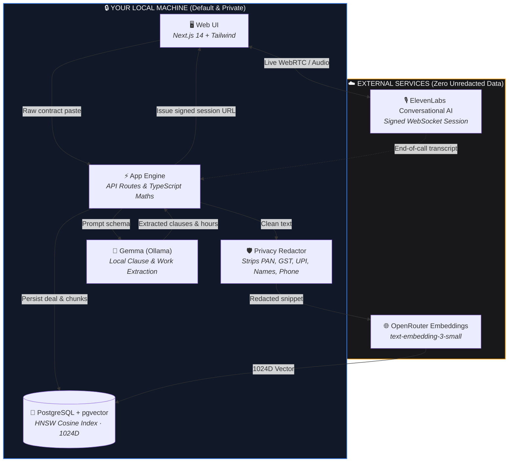
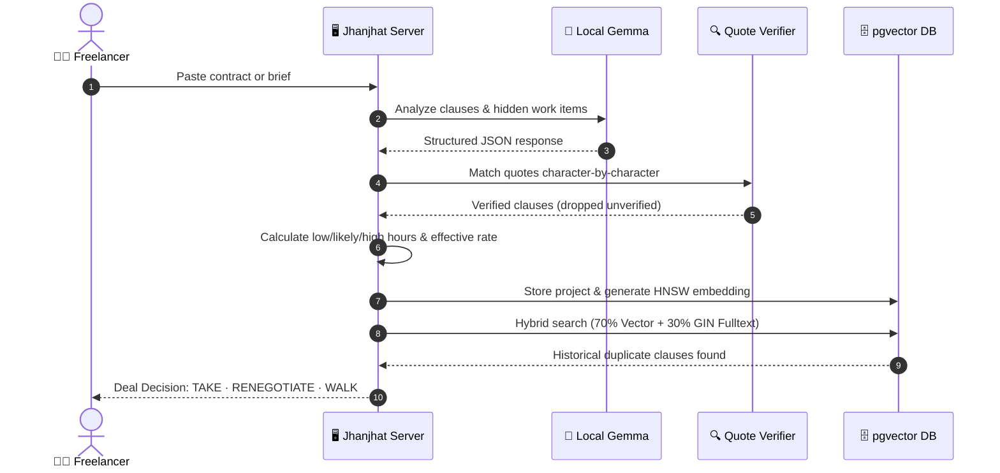
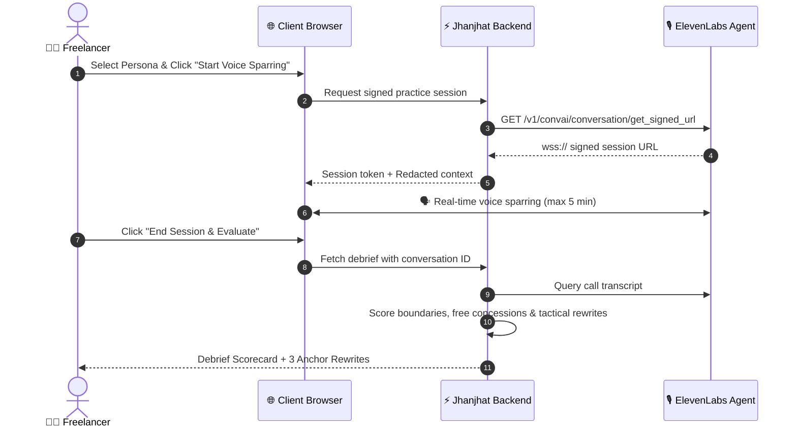
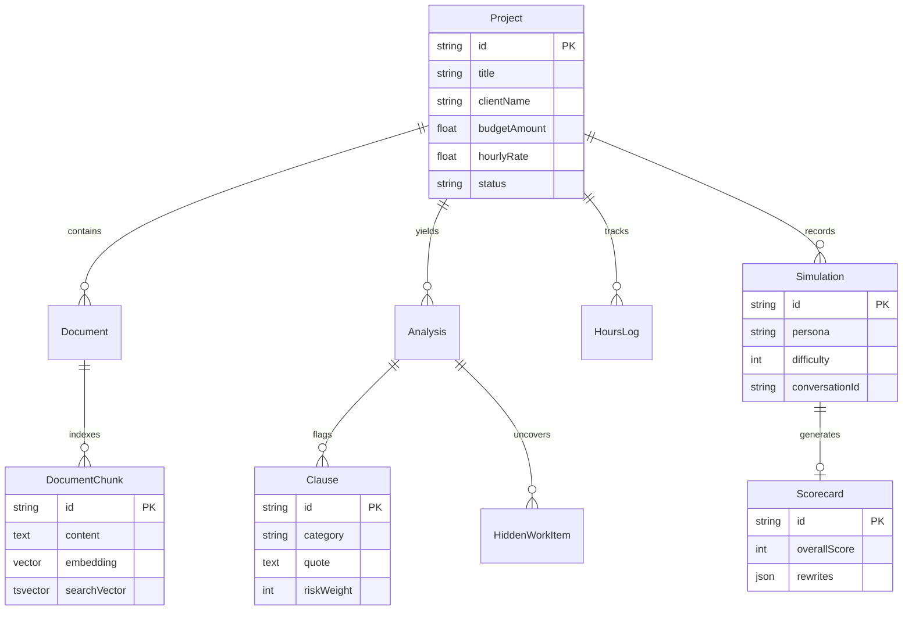

# Jhanjhat (झंझट)

<p align="center">
  <strong>Read the deal, count the hours, rehearse the call — before you say yes.</strong>
</p>

<p align="center">
  
  
  
  
  
</p>

---

## 💡 The Problem in 30 Seconds

A client calls with a "simple landing page" for **₹8,000**.
*“Ho jayega, ma'am.”*
Two seconds later: *“Ek order form bhi chahiye, aur payment launch ke baad kar denge, theek hai?”*

Three weeks later: the 10-hour job took 41 hours. The order form became an inventory system, there were four redesign rounds, and your effective rate collapsed to **₹195/hr**. The money was not lost in bad code — it was lost in two seconds of unpracticed silence on a phone call.

**Jhanjhat** is the local-first negotiation shield for freelancers:
1. **Analyze Deals:** Quotes are extracted, verified verbatim against source text, and code-calculated into realistic hours ranges and effective rates.
2. **Rehearse Out Loud:** Hop into an ultra-low latency voice call with an AI client persona (ElevenLabs) armed with the contract's hidden traps.
3. **Get Scored:** Review boundaries held, free concessions made, and get 3 tactical counter-rewrites.

---

## ⚡ Architecture & How It Works

### 1. Privacy-First System Flow

Your raw contracts and client chats stay **strictly local**. The Next.js backend and local Gemma model handle intelligence on-device.



---

### 2. Deal Analysis Sequence

Every extracted clause quote is verified in plain code against the source document. If the LLM hallucinates an unquoted clause, the verifier drops it.



---

### 3. Voice Sparring & Scorecard



---

## 🎯 Feature Matrix

| Feature | Description | Status |
|---|---|:---:|
| **Deal Analysis** | Extracts risky clauses, hidden tasks, scope creep items, and rates | ✅ Verified |
| **Quote Verifier** | Verbatim matching against contract text; drops AI hallucinations | ✅ Verified |
| **Deterministic Maths** | Total hours & effective rate calculated in TypeScript, not LLM guesses | ✅ Verified |
| **Voice Practice Room** | Live audio rehearsal with ElevenLabs conversational agent | ✅ Verified |
| **Negotiation Scorecard** | Tracks concessions surrendered, boundaries defended & 3 rewrites | ✅ Verified |
| **Budget Watch** | Logs actual hours; triggers alerts at 70%, 90%, 100% and below-floor rates | ✅ Verified |
| **Out-of-Scope Check** | Instant check on new client messages: `IN_SCOPE` vs `OUT_OF_SCOPE` with pricing | ✅ Verified |
| **Deal Memory** | PostgreSQL pgvector hybrid search across prior contract clauses | ✅ Verified |
| **Privacy Redactor** | Regex redaction for PAN, Aadhaar, GSTIN, UPI, emails, and phone numbers | ✅ Verified |
| **Kinetic Landing Page** | GSAP staggered reveals and smooth Lenis scrolling with reduced-motion support | ✅ Verified |

---

## 🗄️ Data Model



---

## 🚀 Quickstart

### 1. Prerequisites
- **Node.js 20+** and **pnpm**
- **Docker** (for PostgreSQL + pgvector)
- **Ollama** running locally with `ollama pull gemma4:12b` (or your preferred Gemma model)
- **ElevenLabs API Key & Agent ID** (optional, for live voice sparring)

### 2. Setup

```bash
# Clone the repository
git clone https://github.com/mannubaveja007/Jhanjhat.git
cd Jhanjhat

# Install dependencies
pnpm install

# Start local PostgreSQL with pgvector
docker compose up -d

# Configure environment variables
cp .env.example .env.local

# Push schema and seed demo deals
pnpm db:push
pnpm db:seed

# Launch development server
pnpm dev
```

Visit [`http://localhost:3000`](http://localhost:3000) to open the app.

---

## 🔐 Privacy & Trust Model

| Outside Destination | What is Sent | How It Is Protected |
|---|---|---|
| **OpenRouter** | Redacted chunk text for 1024D embeddings | PII, phone numbers, emails, PAN, GSTIN stripped beforehand. One batched request. |
| **ElevenLabs** | Redacted contract brief, dynamic client persona variables | Session initiated via server-minted signed URL; no API keys exposed to browser. |
| **Local Machine** | Everything else: contract text, clauses, analyses, rates, and SQLite/PostgreSQL storage | Runs entirely on your hardware. |

*Disclaimer: Jhanjhat provides commercial deal intelligence and negotiation rehearsal for informational purposes only, not legal or financial advice.*

---

## 📜 License

[MIT](LICENSE) © 2026 Mannu Baveja. Built for Hacktoberfest Hack Day 2026.
